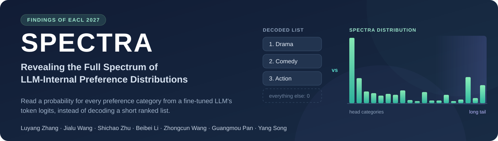
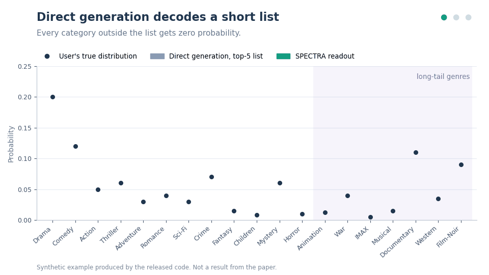
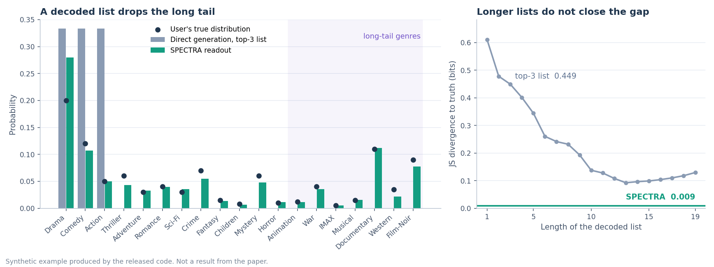
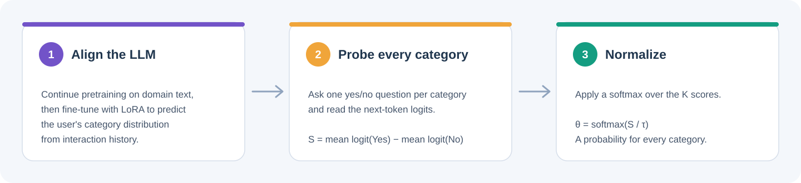

<div align="center">



# SPECTRA

### Revealing the Full Spectrum of LLM-Internal Preference Distributions

**[Luyang Zhang](https://scholar.google.com/citations?user=lIDmS7oAAAAJ&hl=en) · [Jialu Wang](https://scholar.google.com/citations?user=HOtDeN0AAAAJ&hl=en) · Shichao Zhu · Beibei Li · Zhongcun Wang · Guangmou Pan · Yang Song**<br>
**Findings of EACL 2027**

[](#citation)
[](pyproject.toml)
[](https://github.com/LZhang12345/spectra/actions/workflows/tests.yml)
[](LICENSE)

[Quick start](#quick-start) · [Method](#how-it-works) · [Use it in your code](#use-the-readout-in-your-code) · [Probe a model](#probe-a-language-model) · [Documentation](docs/method.md) · [Citation](#citation)

</div>

**The goal is to learn what a user likes across a whole set of categories, such as movie genres or restaurant types.** Language models are usually asked to generate a short ranked list for each user.

**The difficulty is that a list keeps only the top few categories.** Anything outside the list gets zero probability, so frequent categories are overrepresented and long-tail interests disappear. SPECTRA treats preference prediction as a classification task instead. It asks a fine-tuned LLM about each category, reads the answer from the token logits, and returns a probability for every category.

## See the readout

<p align="center">
  
</p>

The dots show one synthetic user's true distribution over 19 movie genres. The loop first decodes a top-5 list, then probes the genres one at a time, then normalizes the scores. Every number shown comes from the released code on a synthetic example. It is not a result from the paper.

## Quick start

Python 3.10 or later is required. The core package needs only NumPy.

```bash
git clone https://github.com/LZhang12345/spectra.git
cd spectra
python -m venv .venv
source .venv/bin/activate
python -m pip install -e .
python -m spectra_probe demo
```

The demo runs on CPU, downloads no model, and compares a decoded list with the two SPECTRA readouts on the synthetic user:

```text
Method                                 JS (bits)  NDCG@10  Tail mass  Categories
Direct generation, top 3                   0.449    0.701      0.000        3/19
Direct generation, top 5                   0.344    0.680      0.000        5/19
SPECTRA, likelihood probing                0.009    0.990      0.279       19/19
SPECTRA, generative classification         0.012    0.922      0.353       19/19
True tail mass: 0.307
```

<details>
<summary>Static plot and the effect of list length</summary>

The figure uses the same synthetic user. The right panel shows that a longer decoded list reduces the gap but does not close it.

<p align="center">
  
</p>

</details>

## Use the readout in your code

Supply a function that maps a list of prompts to next-token logits, one row per prompt:

```python
from spectra_probe import (
    NO_VERBALIZERS, YES_VERBALIZERS, likelihood_probe, single_token_ids,
)
from spectra_probe.prompts import PROBE_QUESTIONS

def next_token_logits(prompts):
    ...  # returns an array of shape (len(prompts), vocabulary size)

yes_ids = single_token_ids(tokenizer, YES_VERBALIZERS)
no_ids = single_token_ids(tokenizer, NO_VERBALIZERS)

readout = likelihood_probe(
    next_token_logits,
    context="Rated movies: Chinatown 5/5; Hoop Dreams 4/5; Annie Hall 4/5.",
    categories=["Comedy", "Documentary", "Drama", "Film-Noir"],
    question=PROBE_QUESTIONS["imperative"]["long_term"],
    yes_ids=yes_ids,
    no_ids=no_ids,
)
print(readout.scores)        # one logit difference per category
print(readout.distribution)  # softmax over the scores
print(readout.top(3))        # the three most likely categories
```

`generative_classification` reads the same distribution from a single multiple-choice prompt, and `hierarchical_probe` handles large category sets with a two-level taxonomy.

## How it works

<p align="center">
  
</p>

For a user history $X$ and categories $c_1,\dots,c_K$, SPECTRA builds a score vector $S\in\mathbb{R}^K$ and returns

$$
\theta_S=\operatorname{softmax}(S/\tau).
$$

**Likelihood probing** asks one yes/no question per category and reads the next-token logits $\mathbf{z}_j$. With small sets of affirmative tokens $V_+$ and negative tokens $V_-$,

$$
S_j=\frac{1}{|V_+|}\sum_{v\in V_+}\mathbf{z}_j[v]-\frac{1}{|V_-|}\sum_{v\in V_-}\mathbf{z}_j[v].
$$

**Generative classification** asks one multiple-choice question and sets $S_j$ to the logit of the answer token for category $c_j$.

**Hierarchical probing** covers large category sets. It first reads a distribution over coarse categories, then probes the fine categories inside selected branches, and multiplies the two:

$$
\theta_S(c)=\theta_S\bigl(L_1(c)\bigr)\cdot\theta_S\bigl(c\mid L_1(c)\bigr).
$$

| Readout | Prompts per user | What is read |
| :--- | :--- | :--- |
| Likelihood probing | $K$ yes/no prompts | Mean affirmative logit minus mean negative logit |
| Generative classification | One multiple-choice prompt | Logit of each category's answer token |
| Hierarchical probing | Coarse categories plus the selected branches | Product of coarse and conditional probabilities |
| Direct generation (baseline) | One generation prompt | A decoded top-$k$ list |

The paper also proves when probing recovers a user's top categories while a decoded list misses the tail. See [the method notes](docs/method.md).

## Probe a language model

Install the model extra and run the interface on a small, randomly initialized GPT-2. This runs on CPU without downloading weights:

```bash
python -m pip install -e '.[models]'
python examples/tiny_model.py
```

For a pretrained model, optionally with a LoRA adapter, this command reads a distribution for each record in a JSON Lines file:

```bash
python -m spectra_probe probe \
  --model Qwen/Qwen3-8B \
  --adapter path/to/lora_adapter \
  --records examples/toy_records.jsonl \
  --variant likelihood \
  --output outputs/readouts.json
```

Each record needs a `context` string. If a record also has a `truth` distribution, the output includes JS divergence and NDCG@10 for that record. Use `--variant generative` for the multiple-choice readout and `--categories file.txt` for your own category list. The two included records only demonstrate the format.

## Results in the paper

The paper evaluates SPECTRA on MovieLens, Yelp, and a large-scale short-video platform. Compared with direct list generation, it reports:

- 38 to 44% lower Jensen-Shannon divergence to the empirical preference distribution on the public datasets
- 23% higher top-3 category exposure entropy on MovieLens
- larger gains for users whose preferences lie in the tail than for users with head preferences
- 41 to 46% higher category NDCG on MovieLens and Yelp

These numbers come from fine-tuned models and full evaluation cohorts. This repository provides the readout and the metrics. See [the reproduction notes](docs/reproduction.md) for what is and is not included.

## Repository guide

| Path | Contents |
| :--- | :--- |
| [`src/spectra_probe/probing.py`](src/spectra_probe/probing.py) | Likelihood probing, generative classification, and hierarchical probing |
| [`src/spectra_probe/prompts.py`](src/spectra_probe/prompts.py) | Probe, multiple-choice, and list-generation prompt templates |
| [`src/spectra_probe/metrics.py`](src/spectra_probe/metrics.py) | JS divergence, NDCG, exposure entropy, and head/tail buckets |
| [`src/spectra_probe/model.py`](src/spectra_probe/model.py) | Next-token logits from a Hugging Face model with an optional LoRA adapter |
| [`src/spectra_probe/toy.py`](src/spectra_probe/toy.py) | The synthetic user and toy language model behind the demo |
| [`examples/`](examples/) | A model example and two illustrative records |
| [`tests/`](tests/) | Tests for the readouts, the metrics, and the demo |
| [`docs/`](docs/) | Method details and reproduction scope |
| [`scripts/build_readme_assets.py`](scripts/build_readme_assets.py) | Regenerates the static plot and its values |
| [`scripts/build_method_animation.py`](scripts/build_method_animation.py) | Regenerates the animation, its final frame, and its values |

## Development

```bash
python -m pip install -e '.[dev,models,plots]'
python -m pytest -q
ruff check .
python scripts/build_readme_assets.py
python scripts/build_method_animation.py
```

The tests check the score definition, both readouts, the hierarchical factorization, the metric bounds, and the demo. CI runs them on CPU.

## Citation

If this code is useful in your work, please cite our paper:

```bibtex
@inproceedings{zhang2027spectra,
  title={SPECTRA: Revealing the Full Spectrum of LLM-Internal Preference Distributions},
  author={Zhang, Luyang and Wang, Jialu and Zhu, Shichao and Li, Beibei and Wang, Zhongcun and Pan, Guangmou and Song, Yang},
  booktitle={Findings of the Association for Computational Linguistics: EACL 2027},
  year={2027}
}
```

## Acknowledgments and license

We thank the authors of [Transformers](https://github.com/huggingface/transformers), [PEFT](https://github.com/huggingface/peft), and [PyTorch](https://github.com/pytorch/pytorch), and the maintainers of the [MovieLens](https://grouplens.org/datasets/movielens/) and [Yelp Open](https://business.yelp.com/data/resources/open-dataset/) datasets. The code is released under the [MIT License](LICENSE).
